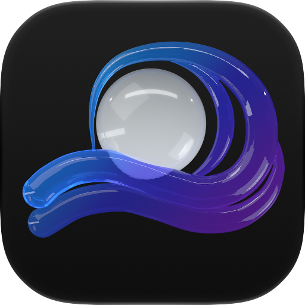
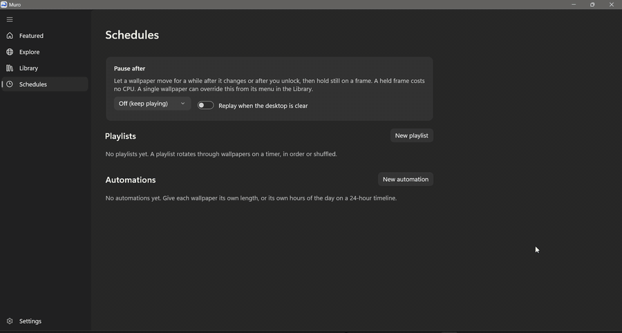

<div align="center">



# Muro for Windows

### Live and interactive wallpapers for your Windows desktop, with low CPU and RAM usage.


[](../../releases/latest)
[](https://github.com/MrRockySL/Muro)

</div>

---

> Inspired by the original [Muro for macOS](https://github.com/MrRockySL/Muro) by
> [MrRockySL](https://github.com/MrRockySL). Windows version made by
> [Wizard-With-A-Light-Saber](https://github.com/Wizard-With-A-Light-Saber), built with the original author's permission.

## Why this exists

A still desktop picture is a waste of a good screen, and most live wallpaper apps for Windows come with a catch: a
subscription, a paid tier holding the good wallpapers back, or an Electron shell that sits at hundreds of megabytes of RAM
and keeps your CPU warm all day for a picture that moves.

Muro for Windows brings the original Muro to Windows. The wallpaper catalog is the same one the macOS app uses.

## What Muro does

Muro plays looping video wallpapers behind your desktop icons on every display, and lets you browse a gallery of them. It
is a native Windows app (C# and WinUI 3) that hands video decoding to your graphics hardware instead of the CPU, and
pauses itself the moment you can't see it.

No account, no ads, no analytics. Everything in the app is unlocked.

---

## Features

- 🌙 **Live video wallpapers.** Looping, seamless, on every display at once, decoded by your GPU.
- 🪄 **Interactive wallpapers.** Pages that draw themselves and follow your pointer and the sound your PC plays. New ones
  arrive in Explore without an app update, and you can import your own. Desktop only, and they use more CPU and RAM than a
  live wallpaper.
- 🔒 **Lock screen picture.** Windows cannot play video on the lock screen, so Muro shows one frame of your wallpaper there.
  Your own picture comes back when you switch it off.
- 🖥️ **Screen saver.** Muro can be your screen saver, playing a wallpaper on every display when the PC is idle. How long the
  PC waits is Windows' own setting.
- 🪶 **Very low CPU usage.** Hardware decoding, and a held frame costs no CPU at all.
- 😴 **Pauses itself** for full screen apps and games, display off, screen lock, battery saver and low battery.
- 🖱️ **Play only on the desktop.** Hold a screen still while any window is open on it, and let it play when the desktop is clear.
- ⚡ **Smooth, Efficient or Automatic.** Keep a wallpaper's original frame rate, or use a 30 fps copy for roughly a third of
  the CPU. Automatic only does it for the heaviest wallpapers (4K at 50 fps or more).
- 🖼️ **Explore gallery.** Browse the catalog, preview full screen, download only what you want.
- 🔄 **New wallpapers arrive on their own.** The catalog updates without updating the app.
- 📃 **Playlists on the clock.** Rotate through a set, shuffled or in order: every hour changes right on the hour, every
  30 minutes changes at :00 and :30. The desktop, the lock screen and the screen saver can each play their own.
- ⏱️ **Automations.** Give every wallpaper its own time: ten seconds each, or a full-day timeline where each wallpaper has
  its own hours.
- ⏸️ **Pause after a set time.** Let a wallpaper play for a while after it changes or after you unlock, then hold still on a
  frame. Set it for everything or for one wallpaper, and turn on *Replay when the desktop is clear*.
- 🎨 **Optional effects.** Day / night tint, mouse parallax, an audio flash, an audio visualiser (bars, waveform, particles or
  VU meters), colour looks and your own GLSL shader. All off by default, and Muro tells you what each one costs.
- 🎛️ **Match the accent colour.** The Windows accent colour (taskbar, Start, title bars) can follow your wallpaper.
- 📥 **Import your own.** Drop in any video and it is converted once to HEVC and added to your library. Interactive
  wallpapers too: an HTML page, or a folder with one.
- 🔊 **Sound for your own videos.** Turn on Live Wallpaper Sound in Settings, and videos you import from then on keep their
  sound. The one you set last is the one you hear.
- 🔔 **Tray icon.** Pause, resume and switch wallpapers without opening the app. Your ten most recent wallpapers are in the
  menu, and with several displays each one has its own submenu.
- 🔗 **Links from other apps.** A script, a shortcut or another app can switch wallpaper, pause or resume with a `muro://`
  link. More on that below.
- 🌐 **Eleven languages.** English, Simplified and Traditional Chinese, Japanese, Korean, Spanish, French, German, Italian,
  Brazilian Portuguese and Russian. Muro follows Windows, or you can pick one in Settings.
- 🌗 **Light, Dark or System.** Muro matches Windows, or you choose.
- ✨ **Tells you when there is a new Muro.** *What's new* shows what changed in the release.
- 💾 **Space control.** See what each wallpaper costs on disk, delete what you do not want (imports included), or keep
  them all on another drive.
- 🔒 **Private.** No telemetry. See the [privacy policy](PRIVACY.md).

> Requires **Windows 11 (64-bit)**, which is what Muro is built and tested on. The app targets Windows 10 version 2004 and
> newer, but that is untested. Interactive wallpapers need the Microsoft Edge WebView2 runtime, which is part of Windows 11.
> ARM64 is not built.

---

## What it looks like

<p align="center">
  
</p>

---

## Install

Download the latest release from the [Releases](../../releases/latest) page. There are three ways to run Muro:

| File | What it is |
|---|---|
| `Muro-Setup-<version>.exe` | The installer. Per user, **no administrator rights**. Installs to `%LOCALAPPDATA%\Programs\Muro`, adds a Start menu shortcut, and can start Muro with Windows. |
| `Muro-Portable-<version>-win-x64.exe` | One file that needs nothing installed. Copy it anywhere and double-click. It unpacks itself on the first run. |
| `Muro-<version>-win-x64.zip` | The same folder as a zip. Unzip anywhere and run `Muro.exe`. |

Everything the app needs (the .NET runtime, the Windows App SDK, mpv and ffmpeg) is included.

**Windows SmartScreen will warn once.** Muro is free of a paid code-signing certificate, so Windows says "unknown
publisher" on the first launch. Click **More info**, then **Run anyway**. You can check a download against `SHA256SUMS.txt`.

Open Explore, pick a wallpaper, press **Download**, then **Apply** in the Library. Done.

> Muro keeps running in the notification area after you close the window. That is what keeps your wallpaper playing. Use the
> tray icon to control it, or **Quit Muro** to stop it and bring your own wallpaper back.

To uninstall, use Windows' *Installed apps*. Your library and settings in `%LOCALAPPDATA%\Muro` are left alone. Delete that
folder to remove them as well.

---

## Set it and forget it

Muro can change your wallpaper for you, two ways. Both live on the **Schedules** page.

**On a timer.** Pick a set of wallpapers, give each one a length, and Muro cycles through them. Ten seconds each, or an
hour each. Every change is a crossfade, never a black flash.

**By the clock.** Give each wallpaper its own hours instead. Something calm for the morning, something bright at noon,
something dark at night. Drag the edge of a block on the 24-hour timeline to change its hours.

A **playlist** rotates a set on the clock, in order or shuffled. Every 30 minutes means :00 and :30, every hour means right
on the hour, and any other length is counted from midnight. A playlist that slept through several changes moves on once.

---

## Let it play, then let it rest

A wallpaper does not have to move all day. With **Pause after**, a wallpaper plays for a while after it changes or after you
unlock your PC, then holds still on a frame, which costs no CPU. Set it from ten seconds to an hour, for everything or for a
single wallpaper from its menu in the Library. Turn on **Replay when the desktop is clear** to get the time again whenever
your desktop is clear.

---

## Moving when you are looking, still when you are not

Muro pauses itself the moment you can't see the wallpaper. A paused wallpaper costs no CPU, and it wakes straight away.

- a full screen app or game covers the desktop (you can switch this off);
- the display turns off, or the PC is locked;
- Windows battery saver is on (you can switch this off);
- the battery is low (you choose the level, and it resumes when you plug in);
- **Play only on the desktop**, if you turn it on, freezes a screen while any window is open on it.

---

## Your screen saver too

Turn on **Use Muro as the screen saver** in Settings. It plays a wallpaper on every display when the PC is idle: the desktop
wallpaper, one wallpaper, a playlist or an automation. **Start after** is Windows' own setting, and **Try it now** previews it.

---

## Wallpapers that react to you

A live wallpaper is a video. An interactive wallpaper is a small page that draws itself as it goes, so it can react to what
you do.

**Your pointer.** It follows the pointer on the desktop and answers a click. While the pointer is over an app's window it
stops reacting, so it never gets in the way while you work.

**Your music.** It moves with whatever your PC is playing. Muro only measures how loud the sound is, in memory. It never
records or sends anything, and it does not use your microphone.

Muro's own are in Explore under **Interactive Wallpapers**: Eclipse, White Sand, Grey Silk and Levi Ackerman. New ones
arrive there without an update, and they download only when you ask, each file checked before it is used. You can also
import your own from the Library: an HTML page, or a folder with one. An imported page cannot go online or see your other
files.

Interactive wallpapers work on the desktop only. On the lock screen and the screen saver, Muro uses the wallpaper's still
picture. They use more CPU and RAM than a live wallpaper, because the picture is drawn live, and they pause like one when
the desktop is covered, locked or asleep. Without the WebView2 runtime the still picture plays alone.

<details>
<summary>Making your own</summary>

Muro sends your page these events on `window`:

- `muro:mouse` with `{x, y, inside}`: where the pointer is, 0 to 1 from the top left. `inside` is false when the pointer is
  over an app or on another screen.
- `muro:click` with `{x, y}`
- `muro:audio` with `{bands, bass, mid, treble, level}`: 64 bands of the sound, each 0 to 1.

```js
addEventListener('muro:mouse', e => move(e.detail.x, e.detail.y, e.detail.inside));
addEventListener('muro:audio', e => pulse(e.detail.bass));
```

The page is served from its own folder only. It cannot reach the network, open windows or ask for permissions. Drop the
`.html` file or the folder on the Library page to import it. You can check a page without looking at the screen with
`Muro.Engine.exe --interactive-selftest <index.html>`.

</details>

---

## Sound for your own videos

Videos you import can play with their sound. Turn on **Live wallpaper sound** in Settings, and every video you import from
then on keeps its sound. Wallpapers from the catalog stay silent. The wallpaper with sound that you set last is the one you
hear, and the others go quiet. Videos imported before you turned it on are not changed.

---

## Muro in your language

Muro speaks eleven languages: English, Simplified Chinese, Traditional Chinese, Japanese, Korean, Spanish, French, German,
Italian, Brazilian Portuguese and Russian. It follows your Windows language. To pick another, open Settings, **Language**.

> The translations were written with the help of AI, not by native speakers, and may have mistakes. Corrections are welcome
> as pull requests: each language is one file in [`src/Muro.Core/Strings`](src/Muro.Core/Strings).

---

## Your library, your rules

Every wallpaper in your Library has a delete button, and you can select several and clear them together. Imported videos can
go too. Nothing is deleted without asking, and deleting a wallpaper cleans up everything that pointed at it: playlists,
automations, the lock screen.

Want them on another drive? The Library page has **Change download folder**: pick a folder and Muro moves your wallpapers
there, shows how far it is, and lets you cancel.

---

## Muro tells you when there is a new version

Muro checks this project's GitHub releases when it opens and every few hours. A newer release shows a banner with **What's
new**: a dialog with the release notes and a Download button. It never installs anything by itself, and the automatic check
stays silent if you are offline.

---

## New wallpapers arrive on their own

Wallpapers are not built into the app. Muro reads a catalog from the web every time it opens (and when the window comes to
the front), so new wallpapers appear in Explore with a **NEW** badge, no update needed. A wallpaper is downloaded only when
you press Download or Preview. Videos and interactive wallpapers are hosted by the original Muro's catalog service.

---

## Control Muro from other apps

Muro answers `muro://` links, so a script, a shortcut or another app can change the wallpaper without opening Muro's window:

```powershell
Start-Process "muro://set?id=<wallpaper id>"                       # every display
Start-Process "muro://set?id=<wallpaper id>&display=<monitor id>"  # one display
Start-Process "muro://set?id=<wallpaper id>&surface=lockscreen"    # desktop, lockscreen, screensaver or all
Start-Process "muro://pause"
Start-Process "muro://resume"
```

A link does what picking the same wallpaper in the app does, and it works whether Muro is running or not. Links are carried
out one at a time, in the order you send them, so `set` followed by `pause` ends paused.

Wallpaper ids are in `%LOCALAPPDATA%\Muro\library.json`. A display's id is printed by `Muro.Engine.exe --list-monitors`; it
contains `#` and `&`, so URL-encode it in the link, for example with `[uri]::EscapeDataString($id)` in PowerShell.

Any web page can open a `muro://` link too, so a link can only do safe things:

- `set` works only for a wallpaper that is already in your Library. A link never starts a download.
- A `display` that is not connected right now is ignored.
- A link never opens Muro's window and never shows a message. A link that is ignored is written to
  `%LOCALAPPDATA%\Muro\logs\engine.log` with the reason.

To turn links off, switch off **Links from other apps** in Settings.

---

## Build from source

You need the [.NET 8 SDK](https://dotnet.microsoft.com/download/dotnet/8.0) on Windows.

```powershell
./scripts/fetch-native.ps1                 # libmpv and ffmpeg (LGPL builds) into third_party/
dotnet build Muro.sln -c Release
dotnet test tests/Muro.Core.Tests -c Release
./scripts/publish.ps1                      # the installer, portable exe and zip into dist/ (about 4 minutes)
```

`src/Muro.Cli` is a command-line tool (`muro.exe`) for scripting the library, downloads, playlists and automations. It is for
development and is not in the installer. The full development history, milestone by milestone, with what was measured and
what was not tested, is in [docs/BUILD-LOG.md](docs/BUILD-LOG.md).

---

## How it works

Muro is three small programs sharing one folder:

| Program | Job |
|---|---|
| `Muro.exe` | The app: a WinUI 3 window with Featured, Explore, Library, Schedules and Settings. Closing it does not stop the wallpaper. |
| `Muro.Engine.exe` | The background engine and tray icon. It puts a window behind the desktop icons on each display, plays the wallpaper in it with libmpv on the GPU, applies the pause rules, and runs playlists, automations and effects. It watches `config.json` and follows every change the app makes. |
| `Muro.scr` | The screen saver (the same program Windows runs as a `.scr`). |

Your data is in `%LOCALAPPDATA%\Muro`: `library.json`, `config.json`, `app-settings.json`, your wallpapers, and `logs\`.

| Folder | Contents |
|---|---|
| `src/Muro.App` | The WinUI 3 app |
| `src/Muro.Engine` | The background engine, tray, effects and the interactive page layer |
| `src/Muro.Core` | Library, catalog, schedules and settings logic, with no Windows dependencies |
| `src/Muro.Platform` | Windows shell, window and tray integration |
| `src/Muro.Playback` | libmpv playback |
| `src/Muro.ScreenSaver`, `src/Muro.Portable`, `src/Muro.Cli` | The screen saver, the single-file launcher and the command-line tool |
| `tests/` | Unit tests for the core logic |

---

## Help and feedback

Found a bug or have an idea? [Open an issue](../../issues). Please include your Windows version and, for a bug, the end of
`%LOCALAPPDATA%\Muro\logs\engine.log`.

## Support the original

The wallpapers and the idea come from [Muro for macOS](https://github.com/MrRockySL/Muro) by
[MrRockySL](https://github.com/MrRockySL). If you enjoy Muro, [sponsor the original developer](https://github.com/sponsors/MrRockySL).

---

## Legal

[LICENSE](LICENSE) (PolyForm Shield 1.0.0) · [NOTICE](NOTICE.md) · [COPYRIGHT](COPYRIGHT.md) · [AUTHORS](AUTHORS.md) ·
[PRIVACY](PRIVACY.md) · [TERMS](TERMS.md)

The wallpaper videos and interactive wallpapers shown in Muro belong to their original creators and are not covered by this
licence. See [NOTICE.md](NOTICE.md).
